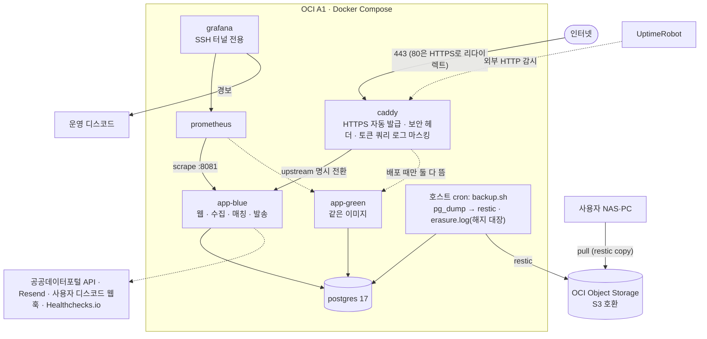

# 아키텍처

> 근거: [PRD v1.0](../prd.md), [설계 3자 종합](../../collab/2026-11-08-design/final.md), [ADR 목록](../adr/)

## 구성도

## 컨테이너
| 컨테이너 | 역할 | 공개 |
|---|---|---|
| `caddy` | HTTPS(기존 도메인), 리버스 프록시, blue/green 전환, 보안 헤더, 접근 로그(토큰 쿼리 제거) | 80, 443만 |
| `app-blue` / `app-green` | 같은 이미지. 평소에는 한쪽만 실행된다 | 없음 (Docker 내부망) |
| `postgres` | 공고, 구독, 발송 작업, 실행 기록, 카운터 | 없음 |
| `prometheus` | 앱 관리 포트(:8081) 수집, 보존 기간은 길게(라벨이 적다) | 없음 |
| `grafana` | 대시보드, 경보 → 운영 디스코드 | 없음 (SSH 터널) |

호스트 포트로 내보내는 건 Caddy의 80과 443뿐이다. 나머지는 Docker 내부 서비스 이름으로 통신한다. 넣지 않은 것과 이유는 [설계 종합 §1](../../collab/2026-11-08-design/final.md)에 있다.

## 앱 패키지 (기능별)
| 패키지 | 내용 |
|---|---|
| `catalog` | 공고, 기관, 코드, 목록 필터, 기관 집계, 화면 컨트롤러 |
| `ingestion` | 공공데이터 API 클라이언트, 최초 적재, 정기 수집, 상세 수집, 완결성 검사, 변경 관측 |
| `subscription` | 구독 신청, 확인, 관리, 해지, 토큰, 동의, 해지 대장 기록 |
| `notification` | 매칭, 발송 작업 생성과 선점, 디스코드·Resend 발송기 |
| `ops` | 회차 선점, 호출 예산, 요청 제한, 지표, Origin 검사 필터 |

## 주요 흐름
**정기 수집** (매시): `collect_run(REGULAR, 슬롯)`을 INSERT해서 선점([ADR-0003](../adr/0003-schedule-dedup-by-slot.md)) → 호출 예산 증가 → `list` 호출 → 완결성 검사 → **한 트랜잭션에서** upsert, 변경 관측, 상태 판정, 새 공고에 대한 디스코드 `NEW` 작업과 항목 생성 → 회차 완료 기록 → Healthchecks 핑

**이메일 묶음** (매일 08:00 KST): `collect_run(DIGEST, 날짜)` 선점 → 구독별로 전날 이후 새 공고와 D-3 공고를 모아 `EMAIL_DIGEST` 작업 하나를 만든다 (항목 유니크로 이미 보낸 공고는 빠진다)

**발송** (매분): `SKIP LOCKED`로 `PENDING` 작업 선점 → 구독 행을 잠그고 상태와 조건을 다시 확인 → 디스코드(`wait=true`, `allowed_mentions` 비움) 또는 Resend(멱등 키) 전송 → `SENT` / 재시도 / `FAILED`. 오래 멈춘 `SENDING`은 회수하고 "결과 불명확"으로 센다

**해지**: 구독 행 잠금 → `erasure.log`에 구독 ID 추가(fsync) → 구독 삭제(작업과 항목은 CASCADE) → 완료 응답

## CI/CD와 배포
1. **PR**: `./gradlew test` (Testcontainers, fixture). 이전 버전 앱이 새 스키마로 동작하는지 확인하는 호환성 테스트도 돈다
2. **`main` 머지**: `ubuntu-24.04-arm`에서 bootJar 빌드 → 이미지(`eclipse-temurin:21-jre`) → GHCR(태그는 커밋 SHA)
3. **배포 job** (동시 실행 금지) → SSH → 서버의 `deploy.sh <sha>` (`flock`으로 잠금)
   1. 비활성 색을 새 이미지로 기동한다 (Flyway는 확장 방향의 변경만 한다)
   2. 내부 readiness와 핵심 화면 응답을 확인한다. 실패하면 새 색을 중지한다 = **롤백**
   3. Caddy upstream을 새 색으로 바꾸고 `caddy reload`한다 (reload가 실패하면 기존 설정이 유지된다)
   4. G4 외부 연속 요청 시험을 한다. 실패하면 upstream을 옛 색으로 되돌린다
   5. 옛 색에 SIGTERM을 보낸다 (graceful shutdown) → 종료 확인 → 활성 색 기록
4. 결과(버전, 전환 시각, G4 결과)를 Actions 로그와 `CHANGELOG.md`에 남긴다

## 백업과 복구 ([ADR-0012](../adr/0012-backup-restic-pull.md), [ADR-0013](../adr/0013-erasure-journal-host-file.md))
- 매일 03:00: `pg_dump -Fc` → restic(암호화) → OCI Object Storage 저장소. 보관 14일(`restic forget --prune`). 성공하면 Healthchecks 핑
- 사용자 NAS·PC: 스케줄 작업으로 `restic copy`를 실행해 OCI 저장소에서 로컬 저장소로 가져온다(pull, 집 쪽 포트 개방 없음). 성공하면 별도 Healthchecks 핑. 며칠 동안 오지 않으면 경보
- 복원: 격리 DB에 덤프를 복원한다 → 모든 발송을 멈춘 채 `erasure.log`를 다시 적용한다 → 검증한 뒤 발송을 재개한다. VM이 사라진 경우의 한계는 ADR-0013에 적는다

## 관측과 경보 ([ADR-0006](../adr/0006-observability.md))
| 대상 | 방법 |
|---|---|
| 웹 생존 | UptimeRobot 외부 HTTP |
| 수집, 이메일 묶음, 백업, NAS 가져오기 | Healthchecks.io heartbeat |
| HTTP p95와 오류율, 마지막 완전 수집, 발송 적체와 실패, 결과 불명확, API 예산 | Prometheus → Grafana 대시보드와 경보 |
| 호스트 자원 | 정해진 시점(평상시, 수집 중, 배포 겹침)에 `docker stats`와 `df`로 실측 기록 |
