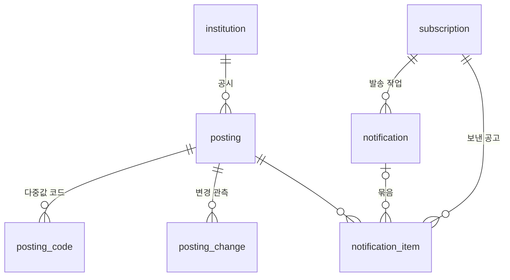

# ERD와 테이블

> 스키마의 원본은 Flyway 스크립트다. 이 문서는 그와 일치해야 한다. 시각은 `timestamptz`, 날짜는 `date`(KST 기준)로 저장한다.

구현 현황 (2026-11-14): `V1__catalog_and_ingestion.sql`은 공고 5개 테이블과 `collect_run`, `api_budget`을 만든다. V2는 마지막 완전 수집 조회용 부분 인덱스와 코드 유형 제약을 추가한다. 아래 `rate_limit`, 구독/발송 테이블은 아직 설계이며 후속 마이그레이션으로 구현한다.

## 공고
| 테이블 | 컬럼 | 제약·인덱스 |
|---|---|---|
| `institution` | `code`(원천 `pblntInstCd`), `name`, `updated_at` | PK `code` |
| `posting` | `sn`(원천 `recrutPblntSn`), `inst_code`, `title`, `bgng_date`, `end_date`, `recrut_se`, `recrut_nope_raw`, `recrut_nope`(숫자로 해석되면 값, 아니면 null), `aply_qlfc`, `pref`, `scrnprcdr`(목록 응답의 설명 필드), `src_url`, `src_url_generic`, `broken_text`, `status`(OPEN/CLOSED/CHECK), `ongoing_yn`, `from_backfill`, `content_hash`, `first_seen_at`, `last_seen_at`, `last_changed_at`, `detail_status`(NONE/DONE/FAILED), `steps`·`files`(jsonb), `detail_collected_at` | PK `sn`; FK `inst_code`; 인덱스 (`status`, `end_date`, `sn`), (`bgng_date`, `sn`), (`inst_code`, `bgng_date`) |
| `posting_code` | `sn`, `type`(NCS/REGION/HIRE/EDU), `code` | PK (`sn`, `type`, `code`); 인덱스 (`type`, `code`, `sn`) |
| `code_name` | `type`, `code`, `name` (응답의 `*NmLst`에서 채운다) | PK (`type`, `code`) |
| `posting_change` | `id`, `sn`, `observed_at`, `changed_fields`(jsonb: 필드별 이전값과 새값) | 인덱스 (`sn`, `observed_at`) |

- 해시와 변경 비교 대상: 제목, 시작일, 마감일, 채용구분, 고용형태, NCS, 지역, 모집 인원, 원문 링크, 자격, 우대, 전형 설명. `decimalDay`, 관측 시각, 배열 순서는 제외한다 (PRD FR-C4)
- 목록의 빈 `steps`/`files`는 저장된 상세를 덮어쓰지 않는다

## 실행과 예산
| 테이블 | 컬럼 | 제약·인덱스 |
|---|---|---|
| `collect_run` | `id`, `kind`(BACKFILL/REGULAR/DETAIL/DIGEST/DEADLINE), `slot`(회차 키: 매시 시각, 날짜, 적재 월), `started_at`, `finished_at`, `result`(COMPLETE/INCOMPLETE/FAILED, 진행 중이면 null), `total_count`, `received`, `inserted`, `changed`, `closed`, `error` | **UNIQUE (`kind`, `slot`)** ← 회차 선점 ([ADR-0003](../adr/0003-schedule-dedup-by-slot.md)) |
| `api_budget` | `day`(KST), `count` | PK `day`. 요청 직전에 별도 커밋으로 증가시킨다(예약) |
| `rate_limit` | `scope`(SUBSCRIBE/RESEND/WEBHOOK_TEST/TOKEN_FAIL/SEND_TOTAL), `key_hmac`, `window_start`, `count` | PK (`scope`, `key_hmac`, `window_start`). 창이 끝나면 지운다 |

## 구독과 발송
| 테이블 | 컬럼 | 제약·인덱스 |
|---|---|---|
| `subscription` | `id`(UUID), `channel`(EMAIL/DISCORD), `status`(PENDING/ACTIVE/DISABLED), `email`, `webhook_enc`(AES-GCM), `webhook_key_id`, `dest_hmac`(정규화한 목적지의 HMAC), `conditions`(jsonb), `kinds`(NEW, DEADLINE), `token_version`, `confirm_token_hash`, `confirm_expires_at`, `consent_version`, `consented_at`, `age_confirmed`, `confirmed_at`, `disabled_reason`, `perm_fail_count`, `created_at`, `updated_at` | PK `id`; UNIQUE `confirm_token_hash`; 인덱스 (`channel`, `dest_hmac`), (`status`, `channel`) |
| `notification` | `id`, `subscription_id`, `kind`(EMAIL_CONFIRM/EMAIL_DIGEST/DISCORD_NEW/DISCORD_DEADLINE/DISCORD_TEST), `batch_key`(슬롯 또는 날짜), `status`(PENDING/SENDING/SENT/RETRY/FAILED/CANCELLED/UNCERTAIN), `attempts`, `next_attempt_at`, `claimed_at`, `sent_at`, `idempotency_key`, `last_error` | FK `subscription_id` **ON DELETE CASCADE**; **UNIQUE (`subscription_id`, `kind`, `batch_key`)**; 부분 인덱스 (`next_attempt_at`) WHERE `status` IN (PENDING, RETRY) |
| `notification_item` | `subscription_id`, `sn`, `kind`(NEW/DEADLINE), `notification_id` | **PK (`subscription_id`, `sn`, `kind`)** ← 공고당 한 번; FK `subscription_id` ON DELETE CASCADE; FK `notification_id` ON DELETE SET NULL |

## 상태 전이
- **공고**: `OPEN → CLOSED`(마감일 경과 또는 `ongoingYn=N`) · `OPEN → CHECK`(완전 수집에서 빠짐) · `CHECK → OPEN`(다시 나타남) · `CHECK → CLOSED`(마감일 경과). 불완전 수집은 상태를 바꾸지 않는다
- **구독**: `PENDING → ACTIVE`(확인 POST, 디스코드는 테스트 메시지 성공) · `ACTIVE → DISABLED`(수신자 단위 영구 거부) · 해지와 미확인 만료는 **행 삭제**
- **발송**: `PENDING → SENDING`(선점) → `SENT` / `RETRY`(일시 실패, `next_attempt_at`) / `FAILED`(재시도 소진) · 대상이 아니게 되면 `CANCELLED` · 회수 시간이 지난 `SENDING`은 `UNCERTAIN`으로 기록하고 다시 `RETRY`

## 보존과 파기 ([ADR-0014](../adr/0014-initial-settings.md))
| 데이터 | 파기 시점 |
|---|---|
| 해지된 구독 | 즉시 삭제 (작업과 항목은 CASCADE). `erasure.log`에 구독 ID만 남는다 |
| 미확인 구독 | 확인 링크가 만료되면 삭제 |
| 비활성(DISABLED) 구독 | 비활성화 30일 뒤 삭제 (사용자가 사유를 볼 수 있는 기간) |
| `notification` | 완료 30일 뒤 삭제. `notification_item`(중복 키)은 구독이 살아 있는 동안 유지한다 |
| `rate_limit` | 창이 끝나면 삭제 |
| 백업 | 14일 (restic 보관 정책) |
