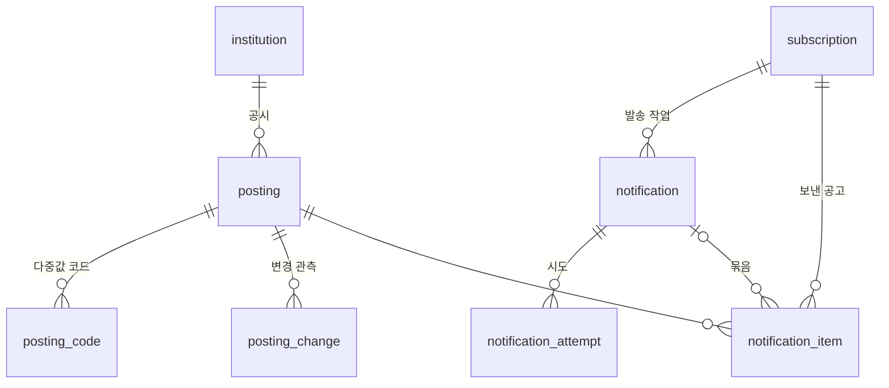

# ERD와 테이블

> 스키마의 원본은 Flyway 스크립트다. 이 문서는 그와 일치해야 한다. 시각은 `timestamptz`, 날짜는 `date`(KST 기준)로 저장한다.

구현 현황 (2026-11-16): `V1__catalog_and_ingestion.sql`은 공고 5개 테이블과 `collect_run`, `api_budget`을 만든다. V2는 마지막 완전 수집 조회용 부분 인덱스와 코드 유형 제약을 추가한다. V3(`V3__collector_runtime_records.sql`, #4)는 `collect_run`에 최초 적재의 기간·월·페이지·고유 수·SN 집합 열과 부분 인덱스를 더하고 `api_attempt`를 만든다. V4(`V4__backfill_start_scan.sql`, #4)는 최초 적재를 시작일 하한 전체 조회(START_SCAN)로 바꾸면서 전략·조회 세대·반영 수와 반영 SN 집합 열을 더한다. 열 추가만 하며 V3 이전 행은 그대로다. V5(`V5__subscriptions.sql`, #6)는 알림의 5개 테이블 `subscription`, `notification`, `notification_attempt`, `notification_item`, `rate_limit`을 만든다(새 테이블만, 이전 버전 앱과 호환). 계약은 [#6 계약](../../collab/2026-11-16-implementation/claude-subscriptions-contract.md)이다.

## 공고
| 테이블 | 컬럼 | 제약·인덱스 |
|---|---|---|
| `institution` | `code`(원천 `pblntInstCd`), `name`, `updated_at` | PK `code` |
| `posting` | `sn`(원천 `recrutPblntSn`), `inst_code`, `title`, `bgng_date`, `end_date`, `recrut_se`, `recrut_nope_raw`, `recrut_nope`(숫자로 해석되면 값, 아니면 null), `aply_qlfc`, `pref`, `scrnprcdr`(목록 응답의 설명 필드), `src_url`, `src_url_generic`, `broken_text`, `status`(OPEN/CLOSED/CHECK), `ongoing_yn`, `from_backfill`, `content_hash`, `first_seen_at`, `last_seen_at`, `last_changed_at`, `detail_status`(NONE/DONE/FAILED), `steps`·`files`(jsonb), `detail_collected_at` | PK `sn`; FK `inst_code`; 인덱스 (`status`, `end_date`, `sn`), (`bgng_date`, `sn`), (`inst_code`, `bgng_date`) |
| `posting_code` | `sn`, `type`(NCS/REGION/HIRE/EDU), `code` | PK (`sn`, `type`, `code`); 인덱스 (`type`, `code`, `sn`) |
| `code_name` | `type`, `code`, `name` (응답의 `*NmLst`에서 채운다) | PK (`type`, `code`) |
| `posting_change` | `id`, `sn`, `observed_at`, `changed_fields`(jsonb: 필드별 이전값과 새값) | 인덱스 (`sn`, `observed_at`) |

- 해시와 변경 비교 대상: 제목, 시작일, 마감일, 채용구분, 고용형태, NCS, 지역, 모집 인원, 원문 링크, 자격, 우대, 전형 설명. `decimalDay`, 관측 시각, 배열 순서는 제외한다 (PRD FR-C4)
- 목록의 빈 `steps`/`files`는 저장된 상세를 덮어쓰지 않는다

### 공고 응답 매핑 (#3, [계약](../../collab/2026-11-15-implementation/claude-ingestion-contract.md))
| 응답 필드 | 컬럼 | 규칙 |
|---|---|---|
| `recrutPblntSn`, `pblntInstCd`, `instNm`, `recrutPbancTtl`, `pbancBgngYmd`, `pbancEndYmd` | `sn`, `inst_code`, `institution.name`, `title`, `bgng_date`, `end_date` | 필수. 하나라도 없거나 형식이 틀리면 응답 전체를 반영하지 않는다(`INVALID_ROW`) |
| `recrutNope` | `recrut_nope_raw`, `recrut_nope` | raw는 원문 문자열. 정수이거나 숫자만 있는 문자열일 때만 `recrut_nope` |
| `aplyQlfcCn`, `scrnprcdrMthdExpln`, `srcUrl` | `aply_qlfc`, `scrnprcdr`, `src_url` | 원문 그대로(공백 정리와 URL 정규화 없음) |
| `prefCondCn`, `prefCn` | `pref` | 읽을 수 있는 라벨 단락: `[우대조건]\n<prefCondCn>` + `\n\n` + `[우대내용]\n<prefCn>`. 없는 쪽 단락은 빼고, 둘 다 없으면 null. 원문(줄바꿈, 제어 문자)은 그대로. 화면은 나누지 않고 줄바꿈만 살려 출력한다 |
| `ncsCdLst`·`workRgnLst`·`hireTypeLst`·`acbgCondLst` (+ `*NmLst`) | `posting_code`(NCS/REGION/HIRE/EDU), `code_name` | 쉼표로 나누고 정렬한다. 이름은 개수가 같을 때만 위치로 짝짓는다 |
| `ongoingYn` | `ongoing_yn` | 상태 판정에 쓴다 |

- `src_url_generic`: http(s) URL 중 경로가 비거나 `/`이고 쿼리가 없을 때, 또는 같은 응답에서 같은 기관의 다른 공고가 같은 URL 문자열을 쓸 때 true. 한 번 true면 URL이 바뀌기 전까지 유지한다. 스킴이 없거나 파싱이 안 되는 URL은 판별하지 않는다(화면이 무효 링크로 처리)
- `broken_text`: 제목, 기관명, 자격, 우대, 전형 설명에 U+FFFD가 있거나 `?` 바로 뒤에 한글 음절이 오면 true. **깨짐 의심 표시이고 복구하지 않는다**
- 비교 대상이 아닌 값(EDU 코드, `ongoing_yn`, 기관명, 품질 플래그)은 바뀌면 덮어쓰기만 하고 `posting_change`를 남기지 않는다

## 실행과 예산
| 테이블 | 컬럼 | 제약·인덱스 |
|---|---|---|
| `collect_run` | V1: `id`, `kind`(BACKFILL/REGULAR/DETAIL/DIGEST/DEADLINE), `slot`(회차 키, 아래), `started_at`, `finished_at`, `result`(COMPLETE/INCOMPLETE/FAILED, 진행 중이면 null), `total_count`, `received`, `inserted`, `changed`, `closed`, `error`. V3: `period_from`·`period_to`(최초 적재 명령의 전체 기간), `range_from`·`range_to`(그 행이 다루는 달), `page_no`(페이지 행만, > 0), `unique_count`(≥ 0, 고유 공고 수), `received_sns`(jsonb 배열: 페이지 행은 그 페이지의 SN, 월 행은 완료 때 검증한 그 달의 SN 집합). V4: `strategy`(`START_SCAN`, V4 이전 월별 행은 null), `scan_generation`(scan·페이지 행: 그 페이지가 속한 조회 세대 = 세대를 시작한 scan 행의 id), `applied_count`(≥ 0)·`applied_sns`(jsonb 배열: 시작일이 목표 기간 안이라 반영한 행의 SN). START_SCAN에서 `total_count`·`received`·`unique_count`·`received_sns`는 **raw**(받은 모든 행) 기준이다 | **UNIQUE (`kind`, `slot`)** ← 회차 선점 ([ADR-0003](../adr/0003-schedule-dedup-by-slot.md)); 부분 인덱스 (`finished_at` DESC) WHERE REGULAR·COMPLETE (V2); 부분 인덱스 (`range_from`, `range_to`, `page_no`) WHERE BACKFILL·COMPLETE (V3); CHECK `jsonb_typeof(received_sns) = 'array'` |
| `api_budget` | `day`(KST), `count` | PK `day`. 요청 직전에 별도 커밋으로 증가시킨다(예약). REGULAR는 `count < 900`, 상세·최초 적재는 `count < 900 − 72`일 때만 증가한다(정기 몫, [ADR-0014](../adr/0014-initial-settings.md)) |
| `api_attempt` (V3) | `id`, `day`, `kind`(REGULAR/BACKFILL/DETAIL), `attempt_no`(1~3), `started_at`, `finished_at`, `outcome`(SUCCESS/HTTP_TIMEOUT/HTTP_CONNECTION/HTTP_STATUS/HTTP_RATE_LIMIT/INTERRUPTED, 결과 저장 전 종료면 null) | FK `day` → `api_budget`; 인덱스 (`day`, `kind`). 예산 예약과 같은 트랜잭션에서 넣는다. `SUCCESS`는 HTTP 200 수신이고 반영 성공이 아니다. 본문·URL·키·예외는 저장하지 않는다 |
| `rate_limit` (V5) | `scope`(SUBSCRIBE/RESEND/WEBHOOK_TEST/TOKEN_FAIL/SEND_TOTAL), `key_hmac`(IP·이메일·웹훅 원문 대신 범위별로 구분한 HMAC), `window_start`, `window_end`, `count` | PK (`scope`, `key_hmac`, `window_start`); 인덱스 `window_end`. 창은 epoch 정렬이라 하루 창은 UTC 날짜(Resend 한도 기준), 한 시간 창은 정시다. `count < 상한`일 때만 증가시킨다([ADR-0010](../adr/0010-rate-limit-and-budget.md)). 끝난 창은 정리 주기(5분)에 지운다 |

`collect_run.slot` 형식: REGULAR는 KST 정시(`2026-11-15T10:00+09:00`), DETAIL은 `{정기 슬롯}/{sn}`, BACKFILL(START_SCAN)은 명령 `command/{수동 슬롯}`, scan `{수동 슬롯}/scan`, 페이지 `{수동 슬롯}/scan/{페이지}`. V4 이전 월별 방식의 `{수동 슬롯}/{월 시작일}`·`{수동 슬롯}/{월 시작일}/{페이지}` 행은 기록으로만 남고 재사용되지 않는다. scan 행과 명령 행의 raw·반영 합계는 받아들인(검증·반영·체크포인트를 마친) 페이지만 센다. 실패로 끝나도 그때까지의 합계를 남긴다. 상세의 공고별 실패 횟수는 같은 sn의 DETAIL 행 중 `FAILED`(예산 소진·종료 제외)로 센다.

`collect_run.error`는 원본 예외 메시지나 요청 URL을 저장하지 않고 100자 이내 내부 오류 코드만 저장한다. API 키·개인정보 노출과 긴 오류 메시지로 결과 갱신이 실패하는 문제를 피한다. 수집 반영의 코드는 `NON_JSON`, `RESULT_CODE_NOT_OK`, `INVALID_ENVELOPE`(FAILED), `INVALID_ROW`, `DUPLICATE_SN`, `COUNT_MISMATCH`, `EMPTY_SNAPSHOT`(INCOMPLETE), `APPLY_ERROR`(FAILED)이다. 원천의 `resultCode` 값은 붙이지 않는다.

## 구독과 발송
| 테이블 | 컬럼 | 제약·인덱스 |
|---|---|---|
| `subscription` (V5) | `id`(UUID), `channel`(EMAIL/DISCORD), `status`(PENDING/ACTIVE/DISABLED), `email`(소문자 정규화), `webhook_enc`(nonce ‖ AES-256-GCM 암호문, AAD = 구독 ID), `webhook_key_id`, `dest_hmac`(정규화한 목적지의 HMAC, 디스코드는 호스트를 `discord.com`으로 통일), `conditions`(jsonb: `ncs`, `region`, `hire`, `career`, `q`. 목록의 상태·정렬·페이지는 없음), `notify_new`, `notify_deadline`, `token_version`, `confirm_token_hash`, `confirm_expires_at`, `consent_version`, `consented_at`, `age_confirmed`, `confirmed_at`, `disabled_at`, `disabled_reason`, `created_at`, `updated_at` | PK `id`; UNIQUE `confirm_token_hash`; **부분 UNIQUE (`channel`, `dest_hmac`) WHERE `status` IN (PENDING, ACTIVE)** ← 목적지당 살아 있는 구독 하나(DISABLED는 막지 않음); 인덱스 (`status`, `channel`); CHECK 알림 종류 하나 이상, 채널별 목적지 열, ACTIVE면 `confirmed_at`, DISABLED면 `disabled_at`, `age_confirmed = true` |
| `notification` (V5) | `id`, `subscription_id`, `kind`(동기: EMAIL_CONFIRM/EMAIL_RECOVER, 성공 기록 전용: DISCORD_TEST, 비동기(#7): EMAIL_DIGEST/DISCORD_NEW/DISCORD_DEADLINE), `batch_key`(동기는 요청별 UUID, 비동기는 슬롯 또는 날짜), `status`(PENDING/SENDING/RETRY/SENT/FAILED/CANCELLED/UNCERTAIN), `attempts`(0~3 = 시도 행 수), `next_attempt_at`, `claimed_at`(펜싱 값), `created_at`, `finished_at`(모든 종결), `idempotency_key`(UUID), `payload_sha256`(현재 키로 보낸 공급자 요청 전체의 해시, 본문·토큰은 저장하지 않음), `last_error`(고정 사유 코드) | FK `subscription_id` **ON DELETE CASCADE**; **UNIQUE (`subscription_id`, `kind`, `batch_key`)**; 부분 인덱스 (`next_attempt_at`) WHERE PENDING·RETRY, (`claimed_at`) WHERE SENDING, (`finished_at`); CHECK 종결 상태 ⇔ `finished_at` 있음 |
| `notification_attempt` (V5) | `id`, `notification_id`, `attempt_no`(1~3), `started_at`, `finished_at`, `outcome`(null = 결과 모름), `http_status` | FK ON DELETE CASCADE; UNIQUE (`notification_id`, `attempt_no`). 발송 예약(`SEND_TOTAL`)과 같은 트랜잭션에서 HTTP 전에 커밋한다. 환불하지 않으며 앞선 결과를 덮어쓰지 않는다 |
| `notification_item` (V5, #7이 채움) | `subscription_id`, `sn`(FK `posting`), `kind`(NEW/DEADLINE), `notification_id` | **PK (`subscription_id`, `sn`, `kind`)** ← 공고당 한 번; FK `subscription_id` ON DELETE CASCADE; FK `notification_id` ON DELETE SET NULL |

## 상태 전이
- **공고**: `OPEN → CLOSED`(마감일 경과 또는 `ongoingYn=N`) · `OPEN → CHECK`(완전 수집에서 빠짐) · `CHECK → OPEN`(다시 나타남) · `CHECK → CLOSED`(마감일 경과) · `CLOSED → OPEN`(마감일이 오늘 이후로 바뀌고 `ongoingYn=Y`로 다시 나타남, 마감 연장). 마감일 경과는 KST 날짜로 `end_date < 오늘`이다(D-0은 진행 중). 불완전 수집과 최초 적재 페이지는 누락 판정을 하지 않는다
- **구독**: 이메일은 `PENDING → ACTIVE`(유효한 확인 POST가 토큰을 소비할 때만. 확인 메일 `SENT`로는 바뀌지 않음) · 디스코드는 테스트 메시지 2xx 뒤 처음부터 `ACTIVE`로 넣는다(실패하면 행이 없다) · `ACTIVE → DISABLED`(수신자 귀책이 명확한 영구 거부: 디스코드 404. 범용 4xx로는 바꾸지 않음) · 해지와 미확인 만료는 **행 삭제**
- **발송**([#6 계약](../../collab/2026-11-16-implementation/claude-subscriptions-contract.md)): 동기 종류는 만들 때부터 `SENDING`이고 요청이 끝낸다. 비동기는 `PENDING`·`RETRY → SENDING`(선점) → 시도 → `SENT` / `RETRY` / 종결. 종결은 2xx가 있으면 `SENT`, 아니면 결과 모름 시도가 하나라도 있으면 `UNCERTAIN`, 아니면 대상 탈락은 `CANCELLED`, 나머지는 `FAILED`. 5분 넘은 `SENDING`의 null 시도는 `UNKNOWN_CRASH`가 되고, 동기 종류는 재발송 없이 종결, 비동기는 시도·수명(23시간)이 남으면 `RETRY`

## 보존과 파기 ([ADR-0014](../adr/0014-initial-settings.md))
| 데이터 | 파기 시점 |
|---|---|
| 해지된 구독 | 즉시 삭제 (작업과 항목은 CASCADE). `erasure.log`에 구독 ID만 남는다 |
| 미확인 구독 | 확인 링크가 만료되면(24시간) 정리 주기(5분) 안에 삭제 |
| 비활성(DISABLED) 구독 | `disabled_at` 30일 뒤 정리 주기 안에 삭제 (사용자가 사유를 볼 수 있는 기간) |
| `notification` | 모든 종결 상태(`SENT`, `FAILED`, `CANCELLED`, `UNCERTAIN`)의 `finished_at` 30일 뒤 삭제. 시도 행은 CASCADE. `notification_item`(중복 키)은 구독이 살아 있는 동안 유지한다 |
| `rate_limit` | `window_end`가 지나면 정리 주기(5분) 안에 삭제. IP·대상 키는 최대 1시간 5분 남는다(앱이 멈춰 있던 시간 제외) |
| 백업 | 14일 (restic 보관 정책) |
